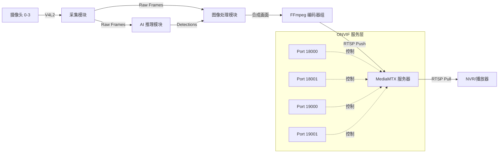

# 软件系统开发设计说明书

## 1. 引言

### 1.1 文档目的
本文档旨在详细描述 Shadow Filter H265 系统的软件架构、模块设计、数据流程及接口定义。文档作为系统开发、维护和后续功能扩展的技术基准。

### 1.2 适用范围
本文档适用于参与本系统开发、测试、部署及维护的技术人员。

### 1.3 术语定义
*   **ONVIF**: Open Network Video Interface Forum，开放型网络视频接口论坛标准。
*   **RTSP**: Real Time Streaming Protocol，实时流传输协议。
*   **YOLO**: You Only Look Once，一种高效的目标检测算法。
*   **MediaMTX**: 开源的高性能 RTSP/RTMP/WebRTC 流媒体服务器。

---

## 2. 系统概述

### 2.1 系统目标
本系统旨在构建一个高性能的多路视频智能处理平台。系统核心功能包括：
1.  **实时采集**: 支持 4 路模拟摄像头的高帧率同步采集。
2.  **智能筛选**: 基于 YOLOv8 算法实时检测目标，动态切换输出画面。
3.  **双模推流**: 同时提供 H.264 和 H.265 编码格式的视频流，适配不同终端。
4.  **标准兼容**: 遵循 ONVIF Profile S/T 标准，无缝对接主流 NVR 和 VMS 平台。

### 2.2 系统架构
系统采用模块化分层架构设计，自底向上分为：
*   **硬件接入层**: 基于 V4L2 协议管理 `/dev/video*` 设备。
*   **核心处理层**: 包含图像预处理、AI 推理引擎、业务逻辑控制。
*   **媒体传输层**: 基于 FFmpeg 进行视频编码，利用 MediaMTX 分发流媒体。
*   **服务接口层**: 提供 ONVIF SOAP 服务和 RTSP 播放接口。

### 2.3 硬件环境依赖
*   **CPU**: x86_64 架构，建议多核高主频。
*   **GPU**: NVIDIA 显卡（支持 CUDA），用于 AI 加速和 NVENC 硬件编码。
*   **视频采集卡**: 支持 V4L2 协议的 4 路模拟视频采集卡。

---

## 3. 模块设计详情

### 3.1 视频采集模块 (Video Acquisition)
*   **类名**: `AsyncCameraCapture`
*   **功能**: 负责从物理设备读取视频帧。
*   **设计机制**:
    *   **异步线程**: 每个摄像头拥有独立的采集线程，避免 I/O 阻塞主进程。
    *   **队列缓冲**: 使用 `collections.deque` (maxlen=1) 仅保留最新帧，确保低延迟。
    *   **异常恢复**: 内置重连机制，当设备断开或读取失败时自动尝试重新初始化。

### 3.2 智能推理模块 (AI Inference)
*   **类名**: `OptimizedMemoryFrameProcessor`
*   **功能**: 执行目标检测任务。
*   **设计机制**:
    *   **Batch Processing**: 将 4 路图像打包为一个 Batch 输入 GPU，显著提升吞吐量。
    *   **内存优化**: 使用 Numpy 视图（View）而非拷贝（Copy）进行图像切片，降低内存带宽占用。
    *   **模型**: 集成 YOLOv8，支持半精度（FP16）推理。

### 3.3 图像处理模块 (Image Processing)
*   **类名**: `SyncFrameProcessor`
*   **功能**: 视频合成与画质增强。
*   **核心算法**:
    *   **画面合成**:
        *   **Monitor Stream**: 拼接 4 路画面为 2x2 网格 (720x720)。
        *   **Filter Stream**: 根据检测置信度动态裁切单路画面 (720x576)。
    *   **时域亮度稳定 (Temporal Brightness)**:
        *   采用指数移动平均 (EMA) 算法平滑亮度变化。
        *   默认目标均值: 110.0，平滑系数: 0.01。
    *   **降噪 (Denoising)**: 支持中值滤波、高斯滤波等多种算法，默认开启中值降噪以去除模拟信号噪点。

### 3.4 视频编码与推流模块 (Encoding & Streaming)
*   **类名**: `RTSPStreamServer`
*   **功能**: 视频压缩与传输。
*   **双编码架构**:
    *   系统同时维护两组编码管道：H.264 (兼容性好) 和 H.265 (压缩率高)。
    *   **H.264**: 使用 `libx264` 软编或 `h264_nvenc` 硬编。
    *   **H.265**: 优先使用 `hevc_nvenc` 硬件编码。
*   **MediaMTX 集成**:
    *   系统内置管理 `mediamtx` 进程，自动生成 `mediamtx.yml` 配置文件。
    *   配置 `source: publisher` 模式，接受 FFmpeg 推送。

---

## 4. 服务接口设计

### 4.1 ONVIF 服务接口
系统模拟了 4 个独立的 ONVIF 设备，分别对应不同的业务需求：

| 端口 | 设备标识 | 编码格式 | 视频内容 | 分辨率 | 适用场景 |
| :--- | :--- | :--- | :--- | :--- | :--- |
| **18000** | Device A | H.264 | 智能筛选 (Filter) | 720x576 | 主流 NVR 录像 |
| **18001** | Device B | H.264 | 全景监控 (Monitor)| 720x720 | 实时监看 |
| **19000** | Device C | H.265 | 智能筛选 (Filter) | 720x576 | 低带宽存储 |
| **19001** | Device D | H.265 | 全景监控 (Monitor)| 720x720 | 高效监控 |

每个端口均提供标准的 WS-Discovery 发现服务和 SOAP 媒体服务。

### 4.2 RTSP 流媒体接口
基于 TCP/UDP 8554 端口，提供以下直接访问地址：
*   `rtsp://<IP>:8554/monitor_h264`
*   `rtsp://<IP>:8554/filter_h264`
*   `rtsp://<IP>:8554/monitor_h265`
*   `rtsp://<IP>:8554/filter_h265`

### 4.3 命令行接口 (CLI)
支持通过命令行参数调整系统行为，关键参数包括：
*   `--model`: 指定模型路径
*   `--conf`: 置信度阈值
*   `--temporal-target`: 亮度目标值 (默认 85.0)
*   `--public-ip`: NAT 穿透 IP 设置

---

## 5. 安全设计

### 5.1 身份认证机制
系统实现了基于 RTSP 标准的摘要/基础认证：
*   **认证范围**: RTSP 拉流、RTSP 推流、ONVIF 接口调用。
*   **配置方式**: 通过环境变量动态注入，避免硬编码。
    *   `RTSP_READ_USER` / `RTSP_READ_PASS`: 读取/播放权限。
    *   `RTSP_PUBLISH_USER` / `RTSP_PUBLISH_PASS`: 推流/发布权限。

### 5.2 权限隔离
*   **Publisher**: 仅允许内部 FFmpeg 进程推送视频流。
*   **Reader**: 外部客户端仅拥有拉流和查看权限，无法修改服务器配置。

---

## 6. 数据流图 (Data Flow)

---

## 7. 附录：配置项清单

| 环境变量 | 默认值 | 说明 |
| :--- | :--- | :--- |
| `RTSP_READ_USER` | shadow | 播放用户名 |
| `RTSP_READ_PASS` | password147 | 播放密码 |
| `RTSP_PUBLISH_USER` | shadow | 推流用户名 |
| `RTSP_PUBLISH_PASS` | password147 | 推流密码 |
